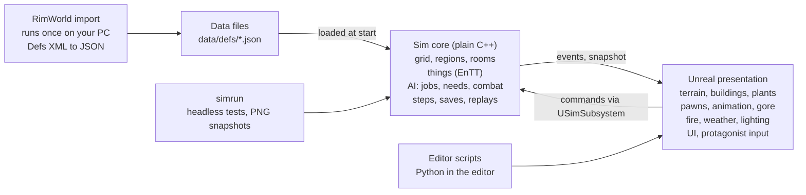

# Colony game: architecture

_Drafted 2026-10-24 with sneed. This file is the source of truth; the original Claude Doc is [here](https://claude.ai/artifact/923qq6ggVEzUfidvsjU2LX)._

The game is two programs in one. A plain C++ **simulation core** owns every rule and every piece of game state, on a 1 m grid like RimWorld's. **Unreal Engine 5** draws that state in 3D, plays the animations and effects, and turns your input into commands for the simulation. Content lives in **JSON data files**, and big third-party art stays out of Git. This split lets most of the game be built and tested in the cloud while your PC is off. It implements the [game design doc](game-design.md). The parts you might want to weigh in on are the risks at the end; the rest is mostly for future Claude threads.

## Ground rules

Every thread working on the game follows these. Breaking one needs a written decision in `docs/decisions/`.

1. **The sim decides, Unreal shows.** Game state lives only in the sim. Unreal never changes it directly; it sends commands. Physics, particles and animation are cosmetic unless the sim asked for them.
2. **The sim has no Unreal code.** It builds and runs on its own with CMake on Linux, Windows and in CI. It includes no Unreal headers and compiles with exceptions and RTTI off, Unreal's defaults.
3. **Content is data.** Every item, building, creature, gene, recipe, event and number lives in JSON files under `data/`. Code holds behaviour, not values.
4. **Text over binary.** Game logic and UI are C++. Blueprints, Widget Blueprints and Animation Blueprints are allowed only as thin glue we can't avoid, and editor work is done by Python editor scripts where possible.
5. **RimWorld numbers are the baseline.** Port values from RimWorld's Defs, then tune with multipliers in `data/tuning.json`. Never invent a number where RimWorld has one.
6. **Deterministic sim.** Same seed plus same commands gives the same game on the same build. All randomness goes through the sim's seeded random streams.
7. **Small context.** `CLAUDE.md` stays under about 150 lines; each system gets one short doc in `docs/design/`; threads read only what their task needs.

## At a glance



Everything on the left of the bridge runs without Unreal, so it can be built and tested in the cloud. Unreal also reads the `visual` fields of the data files to know which mesh or sound to use.

## Simulation core

The sim is a RimWorld-style tick simulation on a 1 m grid, written in plain C++20. It knows nothing about graphics.

**The grid.** A map is up to 1,024 by 1,024 cells, stored as one flat array per layer: terrain, ground height, rock, roof, fertility, snow, filth, fire, gas, light and the building in each cell. Plants are a grid layer too (type and growth per cell), not separate objects, because a 1 km map holds hundreds of thousands of them. The grid is split into 32 m chunks so fire, gas and temperature only update where something is happening. Cells stack in levels about 3 m tall for multi-storey buildings, stored sparsely so empty sky costs nothing. Stairs and ladders link levels for pathfinding.

**Movement is continuous.** Pawn and projectile positions are real 3D coordinates, not cells. The grid is used to plan routes, which are smoothed into natural paths, and pawns steer around each other locally. The grid is for structures and planning only.

**Regions and rooms.** As in RimWorld, connected open cells group into regions, and enclosed regions form rooms. Rooms hold temperature, beauty, cleanliness and role. Regions also answer "can this pawn reach that?" quickly.

**Things.** Pawns, items, buildings, corpses and projectiles are entities in an [EnTT](https://github.com/skypjack/entt) registry. Each has a def (its data file entry) plus components, much like RimWorld's comps: hit points, stack count, apparel, refuelable, power, and so on.

**Time.** The sim steps at a fixed 30 steps per real second at 1x (60 at 2x, 90 at 3x) and keeps game time in game seconds. With a 48-minute day, one real second is 30 game seconds. The importer converts RimWorld's tick-based numbers (2,500 ticks per game hour) into per-hour rates, so its balance carries over. Work is split by cadence: every step (movement, projectiles, aiming), every few game minutes (needs, temperature) and every game hour (plant growth, slow changes). Movement and projectile speeds are in real metres per second at 1x, so a 4 m/s jog stays a 4 m/s jog.

**Determinism and replays.** All randomness comes from seeded random streams, one per system. Commands are applied only at tick boundaries and logged. A replay file (seed plus command log) reproduces any session exactly, so when something goes wrong you press one key and I can replay the bug in the cloud.

**Threading.** Inside Unreal, the sim steps on its own worker thread. After each step it publishes a read-only snapshot and a list of events for Unreal to draw. The first version may run on the game thread through the same interface.

**Saves.** A save is a versioned binary snapshot of sim state. Data is referenced by `defName`, so labels can be renamed freely. A JSON dump of any save is available for debugging.

**Headless runner.** A command-line tool, `simrun`, runs a map or a scripted scenario at full speed with no graphics. It prints stats and writes top-down PNG pictures of the map, which is how I check sim work without your PC.

Libraries, all free and vendored into the repo: EnTT (entities), nlohmann/json (data files), doctest (tests), stb\_image\_write (PNG snapshots), PCG (random numbers).

## Data files

Content is defined the way RimWorld does it, as "defs", but in JSON instead of XML. One folder per kind under `data/defs/` (things, buildings, pawn kinds, xenotypes, genes, recipes, research, incidents, thoughts and so on), many defs per file.

```json
{
  "defName": "Stove_Fueled",
  "parent": "BenchBase",
  "label": "fueled stove",
  "size": [3, 1],
  "stats": { "maxHitPoints": 180, "workToBuild": 2000, "flammability": 1.0 },
  "costs": { "Steel": 80 },
  "comps": [ { "type": "Refuelable", "fuel": "WoodLog", "capacity": 50 } ],
  "visual": { "mesh": "/Game/Buildings/Stove/SM_Stove" }
}
```

- **`defName`** is the permanent ID used by code and saves. **`label`** is the display name and can change at any time.
- **`parent`** inherits from another def, like RimWorld's `ParentName`; `"abstract": true` marks a def that exists only to be inherited.
- **`visual`** holds Unreal-only fields: meshes, materials, sounds, animation sets and effects. The sim ignores it, so art can be swapped without touching game rules.
- **Validation.** A Python checker in CI catches missing references, typos in field names and broken inheritance before anything runs.
- **Hot reload.** A dev key reloads the data files while the game runs, so tuning a number doesn't need a rebuild.

**RimWorld import.** A one-time script reads the Defs XML from your RimWorld install (Core plus each expansion) and produces two things: compact reference summaries in `docs/reference/`, and starter JSON defs with RimWorld's numbers. It runs on your PC. Only the converted output is committed, never RimWorld's raw files.

## Sim to Unreal bridge

Unreal talks to the sim through one narrow interface, owned by a `USimSubsystem` in the game module. Three kinds of traffic cross it, and nothing else.

| Direction | What | Examples |
| --- | --- | --- |
| Unreal to sim | **Commands**, queued and applied at the next tick | Place blueprint, set work priority, designate mining, draft pawn, set speed, protagonist moved, protagonist action, protagonist fired |
| Sim to Unreal | **Events**, a list per tick | Thing spawned, despawned or damaged; pawn started an action; shot fired with hit or miss; fire started; wound added; letter or message for the UI |
| Unreal reads sim | **Snapshot**, read-only | Positions and states for drawing, plus everything the UI shows: pawn info, work tab, room stats |

Unreal works in centimetres with Z up; the sim in metres on the grid. The bridge converts, and nothing else does.

**Smooth motion.** The sim moves pawns in ticks; Unreal keeps the last two snapshots and blends between them each frame, so movement looks smooth at any frame rate. Ground height comes from the sim's height layer.

**The protagonist is a sim pawn with a human driver.** It has needs, skills, health and gear like any colonist. The differences:

- **Movement.** Unreal's character movement moves the protagonist (jumping, slopes, collisions) and sends the position to the sim each tick as a command. The sim checks it against the grid and owns everything else about the pawn.
- **Actions.** Looking at a tree and holding the interact key sends a command that gives the protagonist a normal sim job ("cut this plant"). The job runs at the protagonist's skill speed, with the matching animation.
- **Shooting.** Pulling the trigger sends your aim direction to the sim, which fires a real projectile exactly like anyone else's.
- **All shots** are real projectiles. The sim flies each one with speed, drop and spread, and tests it against terrain, walls and each pawn's body hitboxes (head, torso, arms, legs, posed for standing, crouching or prone). Unreal draws the tracer, impact and hit reaction.
- **Overseer mode** hands the protagonist to the normal pawn AI until you take control again. Possessing another colonist just moves the human-driver flag to them.

## Unreal presentation

Unreal builds the 3D world from the sim's snapshot and events. We use the latest stable UE5 release at setup time and pin it in the repo.

| Part | How it's drawn |
| --- | --- |
| Terrain and mountains | Chunk meshes (32 m) built at runtime from the sim's height and rock layers, with Megascans materials. Mining a rock cell rebuilds one chunk. Not Unreal's Landscape, which can't be generated or dug into at runtime. |
| Buildings, walls, furniture | Instanced static meshes per mesh type per chunk, Nanite where possible. Damage swaps to a worn variant at hit-point thresholds. |
| Destruction | When the sim destroys a building, Unreal spawns a pre-fractured Chaos version that collapses into debris. Debris is cosmetic; the sim places rubble. |
| Plants | Instanced meshes from the sim's plant layer. Felled trees topple with physics. Grass, pebbles and other clutter that don't matter to the game come from Unreal's PCG tools. |
| Pawns and animals | One actor each. Humans use MetaHuman parts assembled by seed through Mutable; animals and mechs use shared skeletons. Motion matching for movement, short montages for actions (chop, mine, eat), and Unreal's animation budget system for crowds. Distant herds of hundreds of animals switch to cheap instanced meshes with baked animation. |
| Gore | Wound decals and blood on the skin material, hidden bones plus a physics severed limb for lost body parts, Chaos ragdolls for the downed and dead, and gib meshes with blood effects for explosions. |
| Fire, gas, weather | Niagara effects placed from the sim's fire and gas layers; volumetric clouds, fog and particles for weather. |
| Lighting | Lumen, virtual shadow maps and DLSS. The sim keeps its own simple light grid for gameplay (work speed, mood). |
| UI | Built in C++ (UMG widgets created in code, no Widget Blueprints) so I can read and edit all of it. Developer tools and inspectors use an ImGui plugin. |
| Protagonist | Character and camera based on Epic's free Game Animation Sample (motion matching, 1st/3rd person). Lyra is heavier than we need. |

Sound plays from sim events (gunshots, footsteps, construction) and from Unreal-side ambience.

## AI

All AI runs inside the sim, so it is tested headless. It copies RimWorld's proven structure for daily life and adds a real tactical layer for combat.

1. **Pathfinding.** A\* on the grid, sped up by searching across regions first and then cells. Path costs include terrain, slope, doors and known danger. Many raiders heading to the same place share one flow field.
2. **Deciding what to do.** Each pawn walks a priority list like RimWorld's think tree: emergencies (on fire, downed, mental break), direct orders, the defense plan, urgent needs, the current schedule block, then work.
3. **Choosing work.** Work types are checked in the pawn's priority order. Each work type's scanners look through ready-made lists (things to haul, blueprints to build, plants to cut) and pick the best target, weighing distance. Reservations stop two pawns taking the same job.
4. **Doing a job.** A job is a short list of steps (go to, pick up, carry, work at, place), each with fail checks, like RimWorld's toils.
5. **Combat.** Each fighter re-plans its position about twice a second and aims every step. Aim works like a player's: reaction time, spread, recoil and leading moving targets, all set by Shooting skill. Fighters strafe, crouch, lean out from cover and dodge grenades and slow projectiles. It scores nearby cells for cover from known enemies, line of sight to a target, weapon range, distance and crowding, then moves, shoots or reloads. A cover map (cover strength per cell in eight directions, from walls, sandbags, rocks and trees) updates only when something is built or destroyed. A shared threat map per faction marks dangerous ground.
6. **Morale and squads.** Each side's squad compares strength (numbers, health, armor, weapons) and moves between advance, hold, fall back and rout. Raider squads use RimWorld's raid plans (assault, siege, sappers, kidnappers, fleeing). Your colony's squad runs the defense plan from the game design doc.

The combat behaviour rules in the game design doc become automated scenario tests, for example "a defender spends no more than 10% of a firefight in the open when cover is within 10 m".

## Repo layout and big assets

The sim lives inside the Unreal project as a plugin, so one copy of the code builds both ways: Unreal compiles it as a module, and CMake builds it alone for tests and the cloud.

```
Rim3D/
  CLAUDE.md            rules and build steps, under 150 lines
  STATUS.md            where we are, what's next
  BACKLOG.md           ideas parked for later
  docs/
    game-design.md     this pair of docs
    architecture.md
    design/            one short doc per system
    reference/         RimWorld numbers, summarised
    decisions/         one short note per decision
  data/
    defs/              JSON content
    tuning.json        global multipliers
  game/                the Unreal project
    Rim3D.uproject
    Source/Rim3D/      Unreal-side C++: bridge, rendering, UI, input
    Plugins/ColonySim/ the sim: plain C++, CMakeLists.txt, tests/, simrun
    Content/           our own Unreal assets
  tools/               Python: RimWorld import, data checker, editor scripts
  assets/manifest.json every third-party asset: source, licence, version
```

**Big assets stay out of Git.** GitHub's free Git LFS allowance is only a few gigabytes, and Megascans, MetaHumans and Fab packs add up to tens of gigabytes. So Git holds code, data, scripts and our own small Unreal assets (through LFS). Third-party packs are listed in `assets/manifest.json` with where to get them, and an editor script re-imports them. You keep one backup copy of the project's Content folder on another drive. If that ever gets awkward, GitHub sells extra LFS storage.

## Testing and where work happens

Most work happens in the cloud. Your PC is needed only for things that touch Unreal, so those are batched into sessions when it's on.

| Work | Where | How it's checked |
| --- | --- | --- |
| Sim code, AI, data files, docs, Python tools | Cloud, any time | Unit tests, scenario tests, `simrun` PNG snapshots, GitHub Actions on every push |
| Unreal-side C++ (bridge, rendering, UI) | Written in the cloud, compiled on your PC | Build plus an automated smoke test that loads a map and takes screenshots |
| Asset import, materials, editor setup | Your PC, through Remote Control and Python editor scripts | Screenshots sent back to the thread |
| Feel, looks, balance | You, playing | Notes go into `BACKLOG.md` or the next stage's plan |

**Three levels of sim tests.** Unit tests check single rules ("a wall blocks a path"). Scenario tests run short scripted games and check outcomes ("20 pawns haul everything within one game day, none get stuck"). Soak runs play hundreds of simulated raids or seasons overnight on GitHub's free cloud machines, not your PC, and report deaths, stuck pawns and balance numbers.

**How a task flows.** One thread per task, on its own branch. The thread reads `STATUS.md` and the one system doc it needs, does the work with tests, opens a pull request, and updates `STATUS.md`. Routine tasks run on Sonnet at medium effort; architecture, combat AI and hard bugs run on Opus at high effort. Two or three threads can run at once if they touch different systems.

## Performance targets

These are the numbers the game must hold on your RTX 5080, checked at the end of each stage. They are starting targets and may move after the Stage 0 tests.

| Target | Value |
| --- | --- |
| Frame rate | 60 fps at 1440p with DLSS, in a 30-colonist base during a 40-raider fight |
| Sim cost | Under 5 ms per frame on average at 3x speed, on its own thread |
| Pawns on screen | About 100 fully animated characters near the camera, plus hundreds of animals farther away |
| Map | 1,024 m by 1,024 m, about 1 million cells, under 2 GB of sim memory |
| Save and load | Under 10 seconds for a mature colony |
| Overnight soak | At least 500 simulated raids per night on a cloud machine |

## Risks and Stage 0 tests

Five things could force a change of plan. The first three are what the Stage 0 tests are for, so we find out in week one or two, not month three.

| Risk | Stage 0 check | Fallback if it fails |
| --- | --- | --- |
| MetaHumans are too heavy for 100 characters, or too rigid for seeded variety and xenotypes | 10 seeded pawns (heavy, thin, an Impid with horns and red skin), then 100 on screen, measuring frame rate | Lower detail at distance, fewer face variants, or MPFB2 bodies |
| Runtime terrain looks worse than Unreal's Landscape | A 1 km map built from a sim heightmap with Megascans materials, compared on screen | A voxel terrain plugin, or a hand-made Landscape for the home map only |
| The sim is too slow at 1 km | 20 pawns pathing and hauling on a 512 m map in `simrun`, then scaled to 1 km | Smaller home map (768 m) or coarser updates far from the colony |
| A C++-only UI is slow to build | Not tested in Stage 0 | The prototype uses quick ImGui panels; the proper styled UI comes in the vanilla core |
| Editor work stalls while your PC is off | Not tested in Stage 0 | Batch all Unreal work into PC sessions and keep cloud threads busy with sim work meanwhile |

Two more risks come from the shooter-style combat and multi-storey decisions. Sim hitboxes may not line up with the body you see, which makes hits feel wrong; the prototype's raid test checks this, and the fix is finer hitboxes fitted to each body type. Multi-storey building adds work to pathing, rooms, roof collapse and the overseer camera; building levels into the sim from day one keeps that cost small.

The Stage 0 results go into `docs/decisions/` and update this doc before Stage 1 starts.
